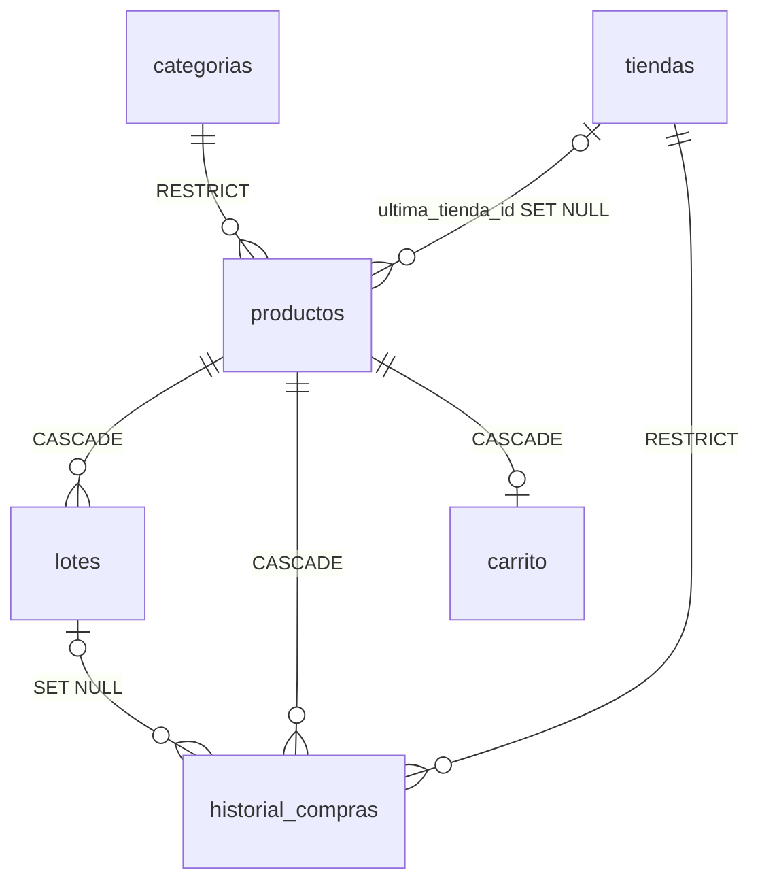

# Mi Alacena — Flutter + sqflite

## Instalación (proyecto `alacena_app`)
1. Copia y reemplaza en tu proyecto: `lib/`, `test/`, `pubspec.yaml`,
   `android/app/build.gradle.kts` y `android/app/src/main/AndroidManifest.xml`
   (no toques `MainActivity.kt` ni el resto de `android/`).
2. `flutter clean && flutter pub get`
3. Ejecuta en Android (emulador o dispositivo), **no en web/Edge**: `flutter run`

> sqflite y las notificaciones no funcionan en web.

## Configuración Android (ya incluida en el zip)

`android/app/build.gradle.kts`
```kotlin
android {
    compileOptions {
        isCoreLibraryDesugaringEnabled = true
        sourceCompatibility = JavaVersion.VERSION_11
        targetCompatibility = JavaVersion.VERSION_11
    }
}
dependencies {
    coreLibraryDesugaring("com.android.tools:desugar_jdk_libs:2.1.4")
}
```

`android/app/src/main/AndroidManifest.xml`
```xml
<!-- dentro de <manifest> -->
<uses-permission android:name="android.permission.POST_NOTIFICATIONS"/>
<uses-permission android:name="android.permission.RECEIVE_BOOT_COMPLETED"/>

<!-- dentro de <application> -->
<receiver android:exported="false"
    android:name="com.dexterous.flutterlocalnotifications.ScheduledNotificationReceiver" />
<receiver android:exported="false"
    android:name="com.dexterous.flutterlocalnotifications.ScheduledNotificationBootReceiver">
    <intent-filter>
        <action android:name="android.intent.action.BOOT_COMPLETED"/>
        <action android:name="android.intent.action.MY_PACKAGE_REPLACED"/>
        <action android:name="android.intent.action.QUICKBOOT_POWERON" />
        <action android:name="com.htc.intent.action.QUICKBOOT_POWERON"/>
    </intent-filter>
</receiver>
```

iOS (`ios/Runner/Info.plist`): `NSCameraUsageDescription`, `NSPhotoLibraryUsageDescription`.

## Estructura
```
lib/
├── components/   global_values, theme_app, fecha_utils, dialogos,
│                 product_image, status_chip, producto_tile
├── database/     alacena_db + DAOs (categorias, tiendas, productos,
│                 lotes, compras, carrito)
├── models/       categoria, tienda, producto(+Estatus), lote, compra, carrito_item
├── screens/      dashboard, day_modal, cart, products, product_form,
│                 product_detail, purchase_form, categories, stores,
│                 expiring_today
├── services/     notification_service
└── main.dart
```

## Base de datos

- **Dominio:** `NOT NULL`, `UNIQUE`, `CHECK` (cantidades ≥ 0, compra > 0, unidad en lista, fechas ISO válidas, `alarma IN (0,1)`, `dias_alerta 0–365`).
- **Referencial:** `PRAGMA foreign_keys = ON` + acciones `RESTRICT / CASCADE / SET NULL`.
- **Campo de alarma:** `lotes.alarma`.

## Reglas de negocio → código
| Regla | Dónde |
|---|---|
| FEFO | `LotesDAO.consumirFEFO` (transacción, lotes ordenados por caducidad) |
| Stock total / Agotado | `ProductosDAO._base` (SUM de lotes con cantidad > 0) + `ProductoResumen.estatus` |
| Histórico de tiendas | `ComprasDAO.tiendasDeProducto` (pestaña *Tiendas* del detalle) |
| Última compra | Trigger `trg_historial_ultima_tienda` |
| Alarmas | `NotificationService.reprogramar` (1 aviso por día a las 9:00 → abre *Caducan hoy*) |

## Estatus
| Estatus | Condición | Color / ícono |
|---|---|---|
| Caducado | lote activo con caducidad < hoy | rojo ☠ |
| Sin existencia | stock total 0 o sin lotes | gris 🛒✕ |
| Por caducar | caducidad ≤ `dias_alerta` | naranja ⌛ |
| Por agotarse | stock ≤ `stock_minimo` | azul ↘ |

Calendario: caducidad → fecha del lote más próximo; stock (agotado/por agotarse) → día de hoy. Un punto por artículo.
